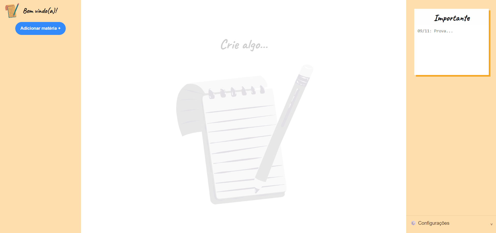
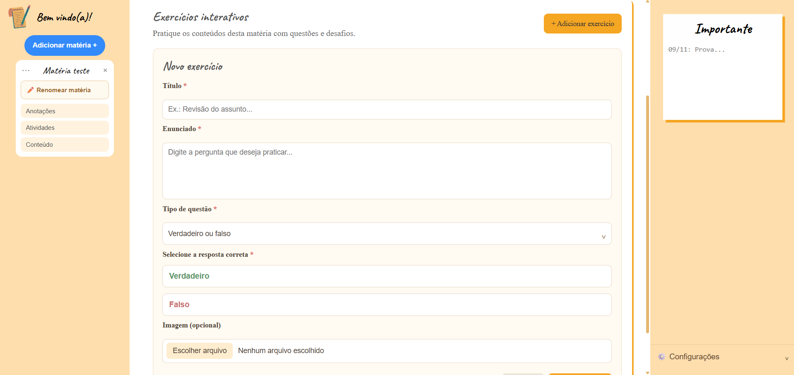

#  Write Study

O **Write Study** é um sistema web de organização acadêmica desenvolvido com o objetivo de ajudar estudantes a organizar sua rotina de estudos em um único ambiente.

A plataforma permite gerenciar matérias, anotações, tarefas, exercícios e conteúdos de estudo, facilitando o acesso e a organização dos materiais acadêmicos.

##  Problema que o projeto busca resolver

Estudantes frequentemente utilizam diferentes ferramentas para organizar suas atividades acadêmicas, como aplicativos de anotações, listas de tarefas e arquivos digitais. Essa divisão pode dificultar o acompanhamento das atividades e a organização dos materiais.

O Write Study surgiu como uma solução para centralizar essas funcionalidades em um único sistema, proporcionando uma experiência mais prática de organização dos estudos.

##  Objetivo

Desenvolver um sistema web que permita aos estudantes organizar suas matérias, registrar anotações, gerenciar tarefas, criar exercícios e armazenar conteúdos de estudo, contribuindo para uma rotina acadêmica mais organizada.

## 👥 Integrantes

- Carlos Vinícius de Alcântara Leite
- Erik Kauan da Silva
- Gabriela Santos Araújo
- Isabelle Ribeiro da Silva
- Renata Lins Marinho dos Santos

##  Tecnologias utilizadas

- **HTML5:** estruturação das páginas.
- **CSS3:** estilização e organização da interface.
- **JavaScript:** implementação das funcionalidades e interações.
- **Supabase:** autenticação de usuários, banco de dados e armazenamento de arquivos.
- **GitHub:** hospedagem do código-fonte e controle de versão.

##  Principais funcionalidades

- **Cadastro e login:** criação de contas e autenticação de usuários.
- **Gerenciamento de matérias:** criação, edição, visualização e exclusão de matérias.
- **Anotações:** registro e organização de anotações relacionadas às matérias.
- **Tarefas:** gerenciamento de atividades e compromissos acadêmicos.
- **Exercícios:** criação e organização de exercícios de estudo.
- **Conteúdos:** armazenamento e gerenciamento de imagens, arquivos PDF, vídeos do YouTube e links externos.
- **Informações importantes:** espaço para registrar informações que precisam de destaque.
- **Configurações da conta:** gerenciamento das configurações e possibilidade de exclusão da conta.

##  Imagens do sistema

Abaixo estão algumas capturas de tela da interface do Write Study.

### Tela de login

### Tela principal

### Área de exercícios

##  Instalação e execução

### Pré-requisitos

- Navegador atualizado, como Google Chrome ou Microsoft Edge.
- Visual Studio Code.
- Extensão Live Server para executar o projeto localmente.
- Acesso às configurações do projeto no Supabase.

## Como acessar o sistema

O Write Study está disponível online pelo GitHub Pages.

**Acesse:** [https://isabelleeribeiro.github.io/Write-Study/]

Basta abrir o link em um navegador para utilizar o sistema.

## Como executar localmente

Caso queira acessar ou modificar o código-fonte:

1. Clone este repositório.
2. Abra a pasta do projeto no Visual Studio Code.
3. Configure as credenciais públicas do Supabase no arquivo `script.js`.
4. Abra o arquivo `index.html` utilizando a extensão Live Server.

##  Gerenciamento do projeto

O gerenciamento das atividades foi realizado por meio do Trello, utilizando listas para acompanhar o andamento do desenvolvimento:

- A fazer;
- Em andamento;
- Em testes;
- Concluído.

A ferramenta foi utilizada para organizar as atividades, distribuir responsabilidades entre os integrantes e acompanhar a execução das etapas do projeto.

**Link do Trello:** [https://trello.com/invite/b/6af51f1050ed8d4b84b9bd2b/ATTI3a64f42224698906d1cc78e025a18abc859B8847/write-study]

##  Documentação

O repositório possui uma pasta destinada à documentação do projeto, contendo os materiais relacionados às etapas de Engenharia de Software, incluindo:

- Diagramas UML;
- Protótipos das interfaces;
- Capturas de tela do sistema;
- Relatório técnico final.

##  Repositório

**GitHub:** [https://github.com/isabelleeRibeiro/Write-Study]

---

Desenvolvido como projeto final da disciplina de **Engenharia de Software**.
